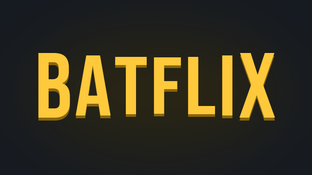
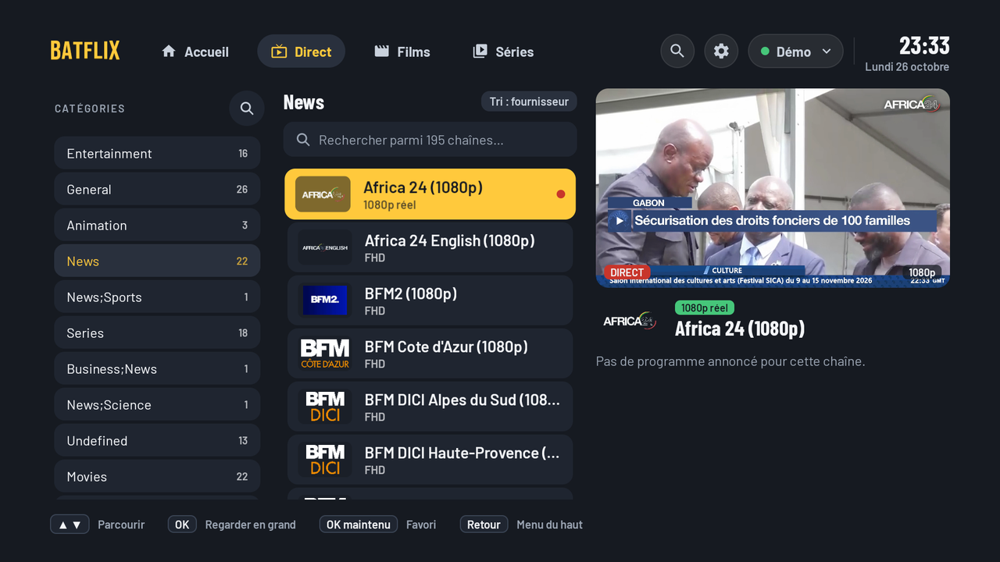
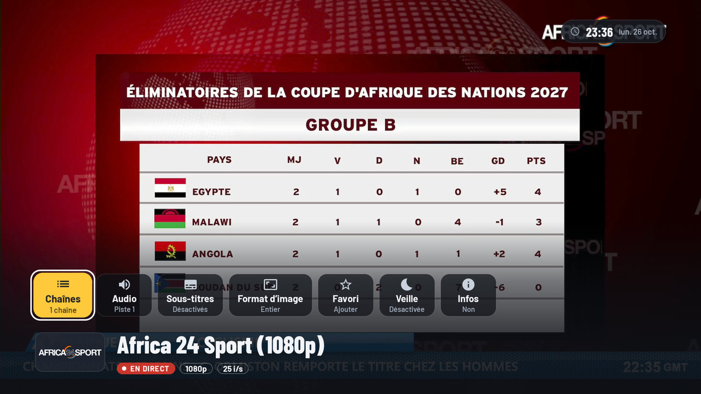
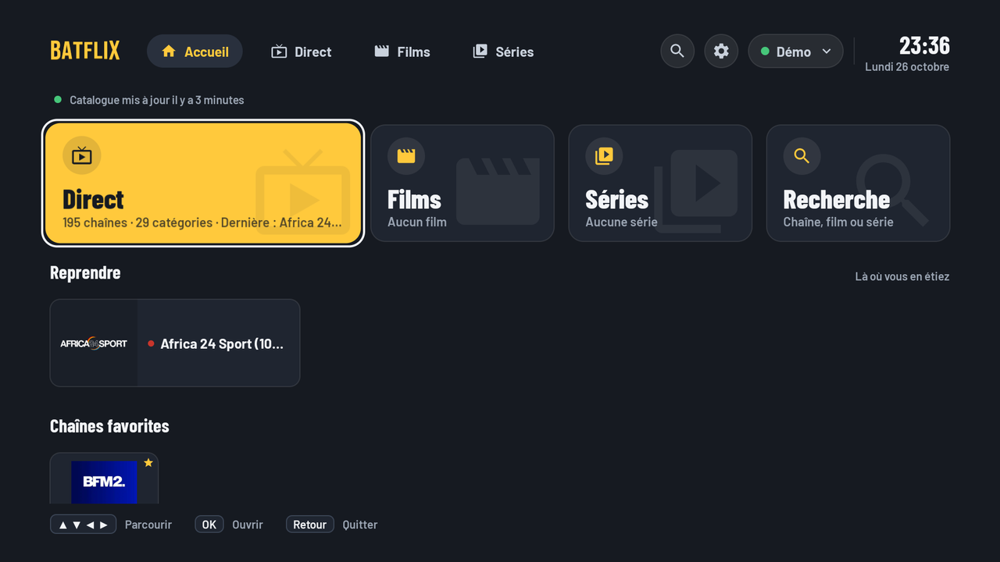
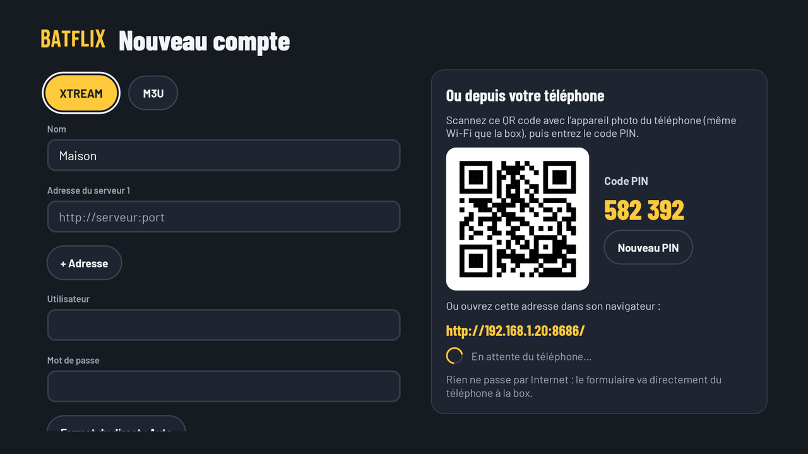

  <b>The IPTV player built for the remote.</b> 
  Live TV, movies and series from your own subscription. Fast, readable from the couch.

  <a href="https://github.com/loudovic12/Batflix-TV/releases/latest/download/Batflix.apk"><b>Download Batflix.apk</b></a>
  · Android TV and Google TV, Android 6+
  · <a href="README.fr.md">Version française</a>

  
  
  

## What it does

| | |
|---|---|
| **Live TV that holds.** When a server stalls, Batflix reconnects on its own, on the same channel or another server of your subscription. Zapping starts in under a second and a half. | **Made for the remote.** Categories left, channels center, live preview right. Voice search, country filter, hold OK for favorites. |
| **Movies and series.** Resume where you stopped, Watch later, favorites, watched marks, sort by newest or A to Z, next episode plays by itself. | **Add your account from your phone.** Scan the QR code on the TV and fill in the form on your phone. It goes straight to the TV over your Wi-Fi, never through the internet. |
| **Several accounts.** Xtream codes or M3U playlists, several servers per account. If one goes down, the others keep working. | **Updates built in.** Batflix tells you when a new version is out, shows what changed and installs it in one click. |

## Screenshots

| Live TV | Full screen |
|---|---|
|  |  |
| **Home** | **Add an account from your phone** |
|  |  |

## Install on your TV

1. On the TV, install **Downloader** from the Play Store (free).
2. In Downloader, enter the code **9415870** (or the address
   `https://github.com/loudovic12/Batflix-TV/releases/latest/download/Batflix.apk`).
3. Allow Downloader to install apps when Android asks, then open Batflix.

After that, Batflix updates itself: each new version shows up with its release notes and an Update button.

## Good to know

- **Batflix provides no channels and no content.** It is a player: you need your own IPTV subscription.
- **Your logins stay on the TV**, encrypted. No Batflix account, no ads, no tracking.
- **Only download Batflix from this page.** Every version is signed, so a modified copy cannot replace yours.
- **Built with the help of AI.** Batflix is designed, tested on real Android TV boxes and maintained by its author,
  with Claude (Anthropic) as a coding assistant.

The screenshots use free, public channels.
